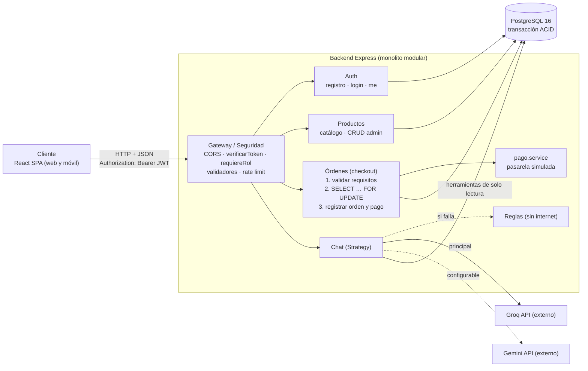

# Tienda USCO — Ecommerce

Proyecto de la electiva **Ingeniería de Software II** (Universidad Surcolombiana).

**Autor:** Santiago García Cuevas (código 20221205107) · **Docente:** Álvaro Javier Gómez · Neiva, 2026

Tienda web con inicio de sesión (JWT y roles), catálogo con búsqueda y filtros, carrito, checkout con **pago simulado**, "Mis pedidos", panel de administración (productos y órdenes) y un chatbot con IA que consulta la base de datos. El objetivo académico es implementar la arquitectura de referencia del curso y, en particular, una **transacción ACID con bloqueo de fila** que evita la sobreventa.

## Documentación de la entrega final

| Fase | Documento |
|---|---|
| 1. Diseño arquitectónico | [Documento de arquitectura (modelo C4)](docs/entrega/Documento-arquitectura-Tienda-USCO.pdf) |
| 2. Núcleo de la plataforma | Este repositorio, [OpenAPI](docs/openapi.yaml) y [esquema de la BD](database/schema.sql) |
| 3. Automatización conversacional | Chatbot v2 (`backend/src/chat/`) |
| 4. Calidad no funcional | [Informe de validación y pruebas](docs/entrega/Informe-validacion-pruebas-Tienda-USCO.pdf) y detalle en [docs/pruebas/](docs/pruebas/) |
| 5. Despliegue y validación final | [Despliegue con Docker Compose](#despliegue-con-docker-compose), [suite E2E](docs/pruebas/07-aceptacion-e2e.md), [manual técnico](docs/manual-tecnico.md) y [manual de usuario](docs/entrega/Manual-de-usuario-Tienda-USCO.pdf) |

## Arquitectura de referencia vs. implementación

| Arquitectura de referencia (matrículas) | Implementación en el ecommerce | Dónde está |
|---|---|---|
| **Cliente** | SPA en React + Vite + TypeScript (web y móvil, responsive) | `frontend/` |
| **API Gateway / Seguridad** | Express: helmet (cabeceras de seguridad), CORS, `verificarToken` (JWT → 401), `requiereRol` (→ 403), límite de intentos de login y de peticiones del chat (→ 429) y validadores (→ 400) | `backend/src/middleware/`, `backend/src/validators/` |
| **Microservicio de matrículas** | Módulo de órdenes (`POST /api/ordenes`) | `backend/src/controllers/ordenes.controller.ts` |
| · Validar requisitos | Validar el cuerpo (items, tarjeta), que el usuario sea cliente y que cada producto exista y esté activo (→ 404) | `validators/orden.validator.ts` |
| · Verificar cupo con bloqueo de fila | `SELECT … FROM productos … ORDER BY id FOR UPDATE` y comparar stock (→ 409 si no alcanza) | `ordenes.controller.ts` |
| · Registrar inscripción | `INSERT` en `ordenes`, `orden_items` y `pagos` y `UPDATE` del stock | `ordenes.controller.ts` |
| **PostgreSQL con transacción ACID** | PostgreSQL 16 en Docker; todo el checkout dentro de `BEGIN … COMMIT` / `ROLLBACK` con un cliente dedicado del pool | `docker-compose.yml` (despliegue) y `docker-compose.dev.yml` (desarrollo), `database/schema.sql` |



## Requisitos

- **Node.js 20 o superior** (probado con v24)
- **Docker Desktop** (para la base de datos en desarrollo o para la solución completa con Compose)
- Git
- Opcional: una API key gratuita de [Groq](https://console.groq.com/keys) para el chatbot. Sin key, el chat responde con reglas.

> La base de datos de desarrollo se expone en el puerto **5434** (solo en 127.0.0.1) para no chocar con instalaciones locales de PostgreSQL en 5432.

## Instalación desde cero

```bash
git clone https://github.com/sagarc399/ecommerce-ing2.git
cd ecommerce-ing2
```

1. **Base de datos.** Con Docker Desktop abierto:
   ```bash
   npm run db:levantar
   ```
   Equivale a `docker compose -f docker-compose.dev.yml up -d` (contenedor `ecommerce_db` en `127.0.0.1:5434`).
   La primera vez, PostgreSQL ejecuta `database/schema.sql` y crea las 5 tablas. El contenedor se reinicia solo cuando se abre Docker Desktop.

2. **Variables de entorno.** Copia los ejemplos y complétalos:
   ```bash
   cp backend/.env.example backend/.env
   cp frontend/.env.example frontend/.env
   ```
   En `backend/.env` genera un `JWT_SECRET` propio:
   ```bash
   node -e "console.log(require('crypto').randomBytes(32).toString('hex'))"
   ```
   Para el chat, pega tu key en `GROQ_API_KEY` (o deja `CHAT_PROVEEDOR=reglas`). Las keys **solo** van en `backend/.env`, que está en `.gitignore`.

3. **Dependencias** (raíz, backend y frontend):
   ```bash
   npm run instalar
   ```

4. **Datos de prueba** (3 usuarios y 12 productos):
   ```bash
   npm run db:reset
   ```

5. **Chequeo previo:**
   ```bash
   npm run verificar
   ```
   Debe terminar en `LISTO PARA LA DEMO`. Si no, muestra cada problema con su solución.

6. **Arrancar** backend y frontend juntos:
   ```bash
   npm run dev
   ```
   Abre http://localhost:5173 (la API queda en http://localhost:3000/api).

## Despliegue con Docker Compose

La solución completa (PostgreSQL, API y frontend con nginx) corre en contenedores con `docker-compose.yml` (proyecto `tienda-usco`, que no choca con la BD de desarrollo):

```bash
cp .env.compose.example .env.compose   # completar contraseña de la BD, JWT_SECRET y la key de Groq
npm run deploy                         # docker compose --env-file .env.compose up -d --build
npm run deploy:demo                    # datos de demostración dentro del contenedor de la API
docker compose ps                      # db, api y web en estado healthy
```

Web en http://localhost:8080 y API en http://localhost:3000/api. Para detenerlo: `npm run deploy:down`. `.env.compose` no se versiona.

**Manual técnico:** [docs/manual-tecnico.md](docs/manual-tecnico.md) (arquitectura, variables, despliegue paso a paso, pruebas y solución de problemas).

## Credenciales de prueba

| Rol | Email | Contraseña |
|---|---|---|
| Administrador | admin@tienda.com | Admin12345 (`ADMIN_EMAIL` / `ADMIN_PASSWORD` en `backend/.env`; `SEED_ADMIN_EMAIL` / `SEED_ADMIN_PASSWORD` en `.env.compose`) |
| Cliente | cliente@tienda.com | Cliente123 |
| Cliente 2 (prueba de concurrencia) | cliente2@tienda.com | Cliente123 |

## Tarjetas de prueba

El pago es **simulado**: no se cobra dinero real y nunca se guarda el número completo ni el CVV (solo los últimos 4 dígitos).

| Número | Resultado |
|---|---|
| 4111 1111 1111 1111 (o cualquier número de 16 dígitos que no termine en 0000) | APROBADO → orden PAGADA, se descuenta el stock |
| 4000 0000 0000 0000 (cualquiera que termine en **0000**) | RECHAZADO → orden RECHAZADA, el stock no cambia |

Vencimiento: cualquier fecha futura en formato MM/AA (ej. 12/28). CVV: cualquier número de 3 dígitos.

## Scripts disponibles (desde la raíz)

| Script | Qué hace |
|---|---|
| `npm run instalar` | `npm install` en la raíz, `backend/` y `frontend/` |
| `npm run dev` | Levanta backend y frontend juntos (prefijos de color `[api]` y `[web]`) |
| `npm run db:reset` | Vacía las tablas, reinicia los ids y carga los datos de prueba. Se niega a correr con `NODE_ENV=production` |
| `npm run db:demo` | Igual que `db:reset` y además carga datos de demostración coherentes: 48 productos más, 12 clientes y 40 órdenes con su historial (240 registros) |
| `npm run db:poblar` | Suma datos de carga para k6 (25 clientes, productos con stock alto y 80 órdenes). No resetea; úsalo solo para pruebas de rendimiento |
| `npm run verificar` | Chequeo previo: Docker, contenedor, tablas, `.env`, puertos e internet/Groq |
| `npm run prueba:concurrencia` | Dos clientes compran a la vez la última unidad del monitor: debe dar 201 + 409 y stock final 0 |
| `npm run db:levantar` | Levanta la BD de desarrollo (`docker-compose.dev.yml`) |
| `npm run deploy` / `deploy:demo` / `deploy:down` | Despliegue completo con Docker Compose: construir y levantar, cargar la demo, detener |
| `npm run deploy:concurrencia` | Prueba de concurrencia dentro del despliegue con Compose |
| `npm run test:e2e` / `test:e2e:compose` | Suite E2E de aceptación contra desarrollo o contra Compose |

En `backend/` también están `npm run seed`, `npm run build` y `npm start`; en `frontend/`, `npm run build` y `npm run lint`.

## Endpoints de la API

Base: `http://localhost:3000/api`. Todas las respuestas son JSON con nombres en español.

| Método | Ruta | Acceso | Descripción |
|---|---|---|---|
| GET | `/health` | Público | Estado del servidor y de la BD |
| POST | `/auth/registro` | Público | Crea un cliente (el rol siempre es `cliente`) |
| POST | `/auth/login` | Público | Devuelve `{ token, usuario }`. 5 intentos fallidos por IP y correo en 15 min → 429 |
| GET | `/auth/me` | Autenticado | Usuario del token |
| GET | `/productos` | Público | Catálogo activo. Query: `buscar`, `categoria`, `pagina`, `limite` (máx. 50) |
| GET | `/productos/categorias` | Público | Categorías de productos activos |
| GET | `/productos/:id` | Público | Detalle (404 si no existe o está inactivo) |
| POST | `/productos` | Admin | Crea un producto |
| PUT | `/productos/:id` | Admin | Reemplazo completo |
| DELETE | `/productos/:id` | Admin | **Borrado lógico** (`activo = false`) |
| PATCH | `/productos/:id/activar` | Admin | Reactiva un producto |
| GET | `/admin/productos` | Admin | Todos los productos. Query: `buscar`, `activo`, `pagina`, `limite` |
| POST | `/ordenes` | Cliente | Checkout en una transacción: 201 pagada, 402 rechazada, 404 producto no disponible, 409 sin stock |
| GET | `/ordenes/mias` | Cliente | Mis pedidos, del más reciente al más antiguo |
| GET | `/ordenes/:id` | Autenticado | Detalle; un cliente solo ve las suyas (las ajenas dan 404) |
| GET | `/admin/ordenes` | Admin | Todas las órdenes. Query: `estado`, `pagina`, `limite` |
| POST | `/chat` | Público | Chatbot. 10 peticiones por minuto por IP (→ 429) |

Códigos: **400** datos inválidos · **401** sin token o token inválido · **403** sin permiso por rol · **404** no encontrado · **409** conflicto de stock · **402** pago rechazado · **429** demasiadas peticiones · **503** servidor ocupado (pool de conexiones agotado).

## Decisiones de diseño

- **Transacción del checkout.** Un cliente dedicado del pool ejecuta `BEGIN`, bloquea los productos con `SELECT … FOR UPDATE`, valida existencia y stock, simula el pago, registra orden, items y pago, descuenta el stock y hace `COMMIT`; ante cualquier error, `ROLLBACK`. La evidencia (con y sin `FOR UPDATE`) está en `docs/evidencias/pruebas-backend.md`.
- **`ORDER BY id` en el bloqueo.** Dos transacciones siempre bloquean las filas en el mismo orden, lo que evita deadlocks cuando dos carritos comparten productos.
- **El total sale de la BD.** El backend ignora cualquier precio o total que envíe el cliente y calcula con los precios de la tabla `productos` (en centavos, para evitar errores de redondeo).
- **Respaldo con `CHECK (stock >= 0)`.** Aunque el código fallara, la BD nunca acepta stock negativo.
- **Borrado lógico** de productos: las órdenes históricas siguen apuntando a productos existentes.
- **404 en órdenes ajenas** (en lugar de 403), para no revelar que la orden existe.
- **SQL parametrizado** (`$1, $2…`) en todas las consultas, sin ORM (`pg`); probado contra inyección SQL.
- **Contraseñas con bcrypt** (bcryptjs, 10 rondas) y JWT con `{ id, rol }`; el login responde el mismo mensaje si falla el email o la contraseña.
- **Datos de tarjeta**: solo viven en el estado del formulario; el backend guarda únicamente los últimos 4 dígitos y nunca los escribe en logs.
- **Chatbot con patrón Strategy**: `ProveedorChat` con implementaciones Groq, Gemini y reglas; `CHAT_PROVEEDOR` elige el principal y, si falla (timeout de 8 s, 429, 5xx, key inválida, sin red), responde el de reglas. Las keys solo están en el backend.
- **Imágenes locales** (`frontend/public/productos/`) para que el catálogo no dependa de internet en la demo.
- **Validación en los dos lados**: el frontend da retroalimentación inmediata y el backend es la autoridad.
- **Pool de conexiones con tiempo máximo de espera** (5 s): ante saturación responde 503 en lugar de quedarse colgado (corrección REN-01).
- **Cabeceras de seguridad** con helmet en la API y con nginx en el frontend (CSP, X-Frame-Options, nosniff); sin `X-Powered-By`.
- **Base de datos no expuesta**: en desarrollo solo escucha en 127.0.0.1; en Compose no publica su puerto y usa una contraseña propia.
- **Contenedores sin root**: la API corre como `node` y la web como `nginx`.

## Limitaciones conocidas

- **No son microservicios reales**: es un backend modular (un solo proceso Express y una sola BD). Los módulos están separados por rutas, controladores, servicios y validadores, pero se despliegan juntos.
- **La latencia del pago simulado ocurre dentro de la transacción** (500 ms con las filas bloqueadas). Con una pasarela real convendría reservar stock, cobrar fuera de la transacción y confirmar o liberar después.
- **El token se guarda en `localStorage`**, expuesto a XSS. En producción se usaría una cookie `HttpOnly` + `SameSite` y tokens de refresco.
- **No hay HTTPS en local.** En producción iría detrás de un proxy con TLS.
- El plan gratuito de Groq tiene cuotas; si se agotan, el chat responde con reglas.
- **Una sola instancia por contenedor**: hay healthchecks y respuesta 503 ante saturación, pero no réplicas ni balanceador de carga (no es alta disponibilidad real).
- **Sin colas de mensajes**: toda la comunicación es síncrona (REST). El cobro asíncrono con reserva de stock está propuesto en la hoja de ruta (REN-03).
- Los hallazgos pendientes de las pruebas, con su prioridad y esfuerzo, están en [docs/pruebas/06-matriz-calidad.md](docs/pruebas/06-matriz-calidad.md).

## Estructura

```
database/          schema.sql (5 tablas)
backend/           API REST (Express + TypeScript) y su Dockerfile
  src/chat/          chatbot: proveedores (Strategy), herramientas y system prompt
  src/controllers/   lógica de cada recurso
  src/middleware/    JWT, roles, límites de peticiones y manejo de errores
  src/validators/    validación de entradas
  src/scripts/       seed, reset, demo, poblar y prueba de concurrencia
frontend/          SPA React (Vite + Tailwind), Dockerfile y configuración de nginx
scripts/           verificar.mjs (chequeo previo a la demo)
pruebas/           rendimiento (k6), usabilidad (Playwright, axe), seguridad (ZAP) y regresión/E2E
docs/              arquitectura, OpenAPI, manual técnico, guion de la demo
  entrega/           PDF de la entrega final
  pruebas/           informes 00 a 07 y capturas
docker-compose.yml       solución completa (db, api, web)
docker-compose.dev.yml   solo la base de datos para desarrollo
```
